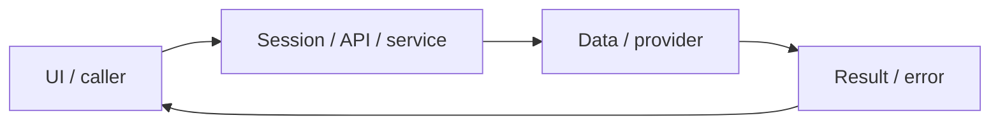

# System design — ai-grading

[Đặc tả](README.md) · [Functions](functions.md) · [UI](ui.md)

## Luồng thực tế

POST grade → SQL queued → BullMQ → worker → OpenRouter → validate JSON → SQL completed/failed → GET jobs → GradeModal

Sơ đồ khái quát ranh giới; chuỗi phía trên nêu rõ worker/provider/storage có áp dụng cho feature này.

## Dữ liệu và ownership

submissions SQL là nguồn trạng thái bền vững; Redis giữ queue. Worker còn xử lý exam-writing. AI cùng adapter cũng dùng sinh học liệu/Tutor/transcript feedback.

API cá nhân luôn lấy user từ session ở [api](../../../lib/api.ts), không nhận user_id tùy ý từ request. Mutation dùng JSON/Origin; lỗi auth 401/403 không phải dữ liệu trống hợp lệ.

## Hợp đồng tích hợp

- POST /api/submissions/grade — {sentenceId,userTranslation,requestId,forceRegrade}; cached report 200 hoặc {jobId,status} 202.
- GET /api/jobs?id=... — {status,error,report}; chủ khác 404.

## Failure modes và vận hành

Đã có smoke OpenRouter thật trong audit trước, không thay bộ chuẩn do người chấm. Cần kiểm định sư phạm và drift model; provider 401/429/5xx không được giả thành điểm hợp lệ.

Phụ thuộc chung: [session/authorization](../../shared/auth-and-api.md), [storage/migrations](../../shared/data-model.md), [vận hành](../../shared/operations.md). Chỉ tên biến môi trường được ghi ở docs; không đưa token, cookie hay credential vào ví dụ/log.
