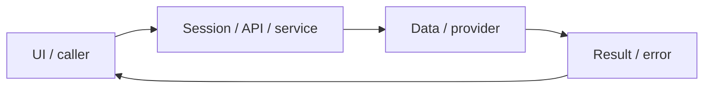

# System design — ai-grading

[Đặc tả](README.md) · [Functions](functions.md) · [UI](ui.md)

## Luồng thực tế

POST grade → SQL queued → BullMQ → worker → OpenRouter → validate JSON → SQL completed/failed → GET jobs → GradeModal

Sơ đồ khái quát ranh giới; chuỗi phía trên nêu rõ worker/provider/storage có áp dụng cho feature này.

## Dữ liệu và ownership

submissions SQL là nguồn trạng thái bền vững; Redis giữ queue. Worker còn xử lý exam-writing. AI cùng adapter cũng dùng sinh học liệu/Tutor/transcript feedback.

API cá nhân luôn lấy user từ session ở [api](../../../apps/api/src/auth/jwt.guard.ts), không nhận user_id tùy ý từ request. Mutation dùng JSON/Origin; lỗi auth 401/403 không phải dữ liệu trống hợp lệ.

## Hợp đồng tích hợp

- POST /api/submissions/grade — {sentenceId,userTranslation,requestId,forceRegrade}; cached report 200 hoặc {jobId,status} 202.
- GET /api/jobs?id=... — {status,error,report}; chủ khác 404.

## Failure modes và vận hành

Đã có smoke OpenRouter thật trong audit trước, không thay bộ chuẩn do người chấm. Cần kiểm định sư phạm và drift model; provider 401/429/5xx không được giả thành điểm hợp lệ.

Phụ thuộc chung: [session/authorization](../../shared/auth-and-api.md), [storage/migrations](../../shared/data-model.md), [vận hành](../../shared/operations.md). Chỉ tên biến môi trường được ghi ở docs; không đưa token, cookie hay credential vào ví dụ/log.

## Bản sửa worker/error boundary — 2026-10-31 (implemented; đặc tả ghi trước code)

Tái sử dụng `log`/`logError` và API boundary `api`→`requestLogging`. Pool idle errors có listener không nhận/log client; worker listeners/startup/recovery/shutdown đều có catch. Fatal process exception/rejection được log an toàn rồi exit1 để supervisor khởi động lại, không tiếp tục process hỏng. AI429 giữ HTTP status và Retry-After kể cả body không phải JSON; cooldown Redis toàn grading queue, retry hữu hạn3lần, lỗi cuối không lưu điểm giả, thông báo giữ nháp. Không đổi model/billing. Kiểm unit fault injection + real Redis/BullMQ cooldown + build/container.

Hợp đồng triển khai đầy đủ: [error handling](../../shared/error-handling.md).

## Retry failed grading —2026-10-31 (đặc tả trước sửa)

POST grade gặp cùng dedup_key đã failed trả409/code GRADING_PREVIOUS_FAILED/submissionId/retryable, không502 và không enqueue tự động. UI giữ nháp, hiện nút Chấm lại bằng AI ngay trong alert (không phụ thuộc report modal); click explicit forceRegrade=true với requestId mới. Polling failure cũng có retry tại chỗ. Cache completed/dedup queued/ownership/rate limit/worker cooldown giữ nguyên.

## ORM data access — 2026-11-01

PostgreSQL dùng TypeORM EntitySchema/QueryBuilder; transaction dùng một QueryRunner, giữ ownership, row lock, CAS/version, JSONB và idempotency. MongoDB vẫn Mongoose. Hợp đồng dùng chung tại [ORM design](../postgresql-orm-migration/system-design.md); chi tiết regression ở [audit tích hợp](../../audits/postgresql-orm-migration.md). UI/layout không thay đổi.

## 2026-11-01 — New click after a failed attempt

A new ordinary POST grade request no longer stops at the old base failed dedup row. The service preserves that history and resolves a separate requestId-keyed attempt, returning202/queue. Replaying the same UUID resolves the same attempt (including409 if that exact retry has failed); a new button click has a new UUID. Completed base reports still return200 cached:true, explicit forceRegrade still works. No automatic new attempt from polling/process recovery and no infinite retry loop. Dedup/error state is durable PostgreSQL data, not in-memory response cache. Implementation: SubmissionsGradeService.post; tests/unit/grading-retry.test.ts and native nest-auth E2E. This supersedes the earlier always409-on-base-failed behavior.

Original request UUID is retained in snapshot.gradingRequestId to distinguish a new click from replay of that original failed request. reportView strips it from returned report sentence. Legacy snapshots without this optional marker remain readable.
