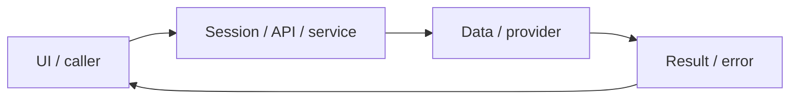

# System design — ai-tutor

[Đặc tả](README.md) · [Functions](functions.md) · [UI](ui.md)

## Luồng thực tế

Library Tutor → POST tutor → embed → pgvector nearest chunks → generateJson → answer/hints/sources

Sơ đồ khái quát ranh giới; chuỗi phía trên nêu rõ worker/provider/storage có áp dụng cho feature này.

## Dữ liệu và ownership

tutor_chunks + pgvector (migration 002); mô hình embedding openai/text-embedding-3-small; chưa có queue riêng cho indexing.

API cá nhân luôn lấy user từ session ở [api](../../../lib/api.ts), không nhận user_id tùy ý từ request. Mutation dùng JSON/Origin; lỗi auth 401/403 không phải dữ liệu trống hợp lệ.

## Hợp đồng tích hợp

- POST /api/tutor — {question,reveal}; {answer,hints,sources}.
- PUT /api/tutor — admin tạo index, {indexed}; thiếu index 503; giới hạn tần suất 429.

## Failure modes và vận hành

Chưa kiểm chứng indexing/retrieval/grounding qua dịch vụ thật. Citation trả từ retrieval, không phải kiểm định mọi câu AI đều được nguồn hỗ trợ.

Phụ thuộc chung: [session/authorization](../../shared/auth-and-api.md), [storage/migrations](../../shared/data-model.md), [vận hành](../../shared/operations.md). Chỉ tên biến môi trường được ghi ở docs; không đưa token, cookie hay credential vào ví dụ/log.
