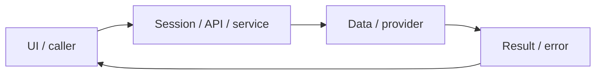

# System design — content-authoring

[Đặc tả](README.md) · [Functions](functions.md) · [UI](ui.md)

## Luồng thực tế

Admin form/AI draft → api(admin) → Mongo Sentence → review → publish → học viên đọc published

Sơ đồ khái quát ranh giới; chuỗi phía trên nêu rõ worker/provider/storage có áp dụng cho feature này.

## Dữ liệu và ownership

Mongo Sentence; nguồn và quyền dùng được ghi thành text, chưa xác minh pháp lý tự động. contentReady chỉ cache quá trình seed trong process.

API cá nhân luôn lấy user từ session ở [api](../../../lib/api.ts), không nhận user_id tùy ý từ request. Mutation dùng JSON/Origin; lỗi auth 401/403 không phải dữ liệu trống hợp lệ.

## Hợp đồng tích hợp

- GET/POST/PATCH /api/admin/content — list/create/generate/review/publish/edit; admin only.
- POST /api/sentences/generate — endpoint cũ, admin nhận 410 để dùng workflow mới.

## Failure modes và vận hành

Cần audit nguồn/quyền học liệu trước phát hành rộng. Một trang tạo index có thể gọi provider nhiều lần; chưa có batching UI.

Phụ thuộc chung: [session/authorization](../../shared/auth-and-api.md), [storage/migrations](../../shared/data-model.md), [vận hành](../../shared/operations.md). Chỉ tên biến môi trường được ghi ở docs; không đưa token, cookie hay credential vào ví dụ/log.
