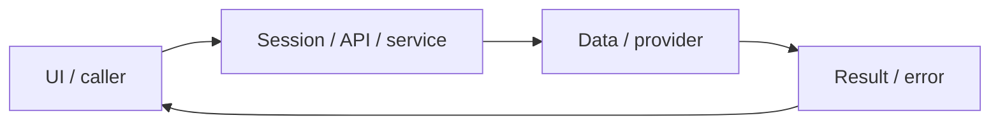

# System design — daily-dashboard

[Đặc tả](README.md) · [Functions](functions.md) · [UI](ui.md)

## Luồng thực tế

Dashboard → GET profile/stats/due/drafts → makePlan → daily_plans → PATCH task → study_days → streak/UI

Sơ đồ khái quát ranh giới; chuỗi phía trên nêu rõ worker/provider/storage có áp dụng cho feature này.

## Dữ liệu và ownership

profiles, vocabulary, drafts, submissions, daily_plans, study_days; Mongo cấp bài mới. Lịch ngày đã tạo không tái sinh vì refresh.

API cá nhân luôn lấy user từ session ở [api](../../../apps/api/src/auth/jwt.guard.ts), không nhận user_id tùy ý từ request. Mutation dùng JSON/Origin; lỗi auth 401/403 không phải dữ liệu trống hợp lệ.

## Hợp đồng tích hợp

- GET /api/dashboard — {profile,plan,dueCount,stats,streak,errors}.
- PATCH /api/dashboard — {day,version,taskId,action:done|skipped|pending|replace}; 409 stale/day rollover.

## Failure modes và vận hành

Chưa có AI lập lịch, notification hoặc cron bắt buộc. Rule-based tạo khi mở dashboard.

Phụ thuộc chung: [session/authorization](../../shared/auth-and-api.md), [storage/migrations](../../shared/data-model.md), [vận hành](../../shared/operations.md). Chỉ tên biến môi trường được ghi ở docs; không đưa token, cookie hay credential vào ví dụ/log.
