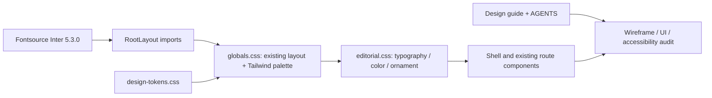

# System design — editorial skin

[Quy chuẩn](../../design/README.md) · [Yêu cầu](README.md).

RootLayout import order: Fontsource CSS → globals.css (imports tokens) → editorial.css. Next bundles CSS/font files; no runtime Google Fonts dependency. OFL license shipped in public/fonts. Inter Variable includes Vietnamese subset; browser fonts.ready/check verified separately from a declared font-family string. Korean uses system fallback; actual device rendering remains device-dependent.

globals.css giữ layout rules/breakpoints hiện có. Token indigo alias trỏ sang Cobalt, slate/amber aliases chuyển neutral để học liệu cũ không tạo theme vàng riêng; semantic đúng/sai giữ màu và nhãn. --yellow là compatibility alias neutral, không còn là màu thương hiệu.

editorial.css chỉ đổi presentation. Các span heading nằm trong h2 cũ; decorations absolute trong hero-art aria-hidden hiện có, pointer-events none, biến mất cùng breakpoint760px. Không thêm cột hoặc tác vụ học. Ngoại lệ sửa inset nội bộ: honor class pl-10 đã có cho search input để chữ không đè icon; khung field và padding container không đổi.

Session/auth/API/queue/database untouched. CSS không cấp quyền hay thay rubric. Source owner Dashboard vẫn daily-dashboard; design-system tham chiếu component và docs dashboard trỏ ngược guide.

Regression guard lưu computed display/grid/flex/gap/padding/max-width/width của container trên 8 route tại1440/390/320. Guard không đo equality chiều cao vì font mới có reflow tự nhiên; review ảnh đối chiếu thêm overflow, order và affordances. Không tự cập nhật baseline để làm test xanh.

Light surface update: editorial.css override đủ .notebook h2/h3/eyebrow/p/error-note del/strong/p/a và empty-note để loại white-on-white khi bỏ inverse. Title, Beta/date, completed task, auth art note, layer artwork dùng sáng/tint. CSS cascade globals→editorial giữ nguyên; không đổi API/component signatures. Test editorial-design.spec.ts thêm empty/filled regression và chuyển focus từ trắng sang Cobalt.
