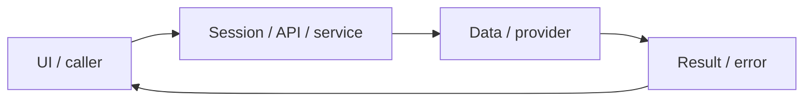

# System design — design-system

[Đặc tả](README.md) · [Functions](functions.md) · [UI](ui.md)

## Luồng thực tế

RootLayout → Shell/useSession → navigation + page → shared CSS tokens

Sơ đồ khái quát ranh giới; chuỗi phía trên nêu rõ worker/provider/storage có áp dụng cho feature này.

## Dữ liệu và ownership

Không có database riêng; Shell đọc Better Auth session; design tokens trong globals.css là nguồn CSS chuẩn.

Shell dùng session để chọn UI; quyền truy cập cuối cùng được bảo vệ ở API, không dựa vào việc ẩn nút.

## Hợp đồng tích hợp

- Không thêm public API; dùng /api/auth/get-session từ authClient.

## Failure modes và vận hành

Session pending/avatar đã sửa trong feature/user-profile; xem [audit tích hợp](../../audits/profile-auth-integration.md). Một số utility colors trong Practice vẫn có màu trạng thái ngữ nghĩa.

Phụ thuộc chung: [session/authorization](../../shared/auth-and-api.md), [storage/migrations](../../shared/data-model.md), [vận hành](../../shared/operations.md). Chỉ tên biến môi trường được ghi ở docs; không đưa token, cookie hay credential vào ví dụ/log.
