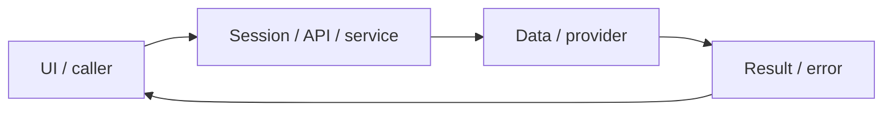

# System design — dictionary

[Đặc tả](README.md) · [Functions](functions.md) · [UI](ui.md)

## Luồng thực tế

Bấm/chọn tiếng Hàn → DictionarySelectionLookup → /api/dictionary → Redis/KRdict → popup + TTS/link

Sơ đồ khái quát ranh giới; chuỗi phía trên nêu rõ worker/provider/storage có áp dụng cho feature này.

## Dữ liệu và ownership

Cache dictionary:ko:vi:<query>; không phải tiến độ lâu dài. Không có tokenizer hình thái học hoàn chỉnh.

API cá nhân luôn lấy user từ session ở [api](../../../lib/api.ts), không nhận user_id tùy ý từ request. Mutation dùng JSON/Origin; lỗi auth 401/403 không phải dữ liệu trống hợp lệ.

## Hợp đồng tích hợp

- GET /api/dictionary?q=... — {configured,items}; KRdict key chỉ server.

## Failure modes và vận hành

Chưa xác minh chất lượng mọi dạng chia động từ; fallback không phải Mecab/KoNLPy. TTS dùng trình duyệt, không đảm bảo có giọng ko-KR.

Phụ thuộc chung: [session/authorization](../../shared/auth-and-api.md), [storage/migrations](../../shared/data-model.md), [vận hành](../../shared/operations.md). Chỉ tên biến môi trường được ghi ở docs; không đưa token, cookie hay credential vào ví dụ/log.
