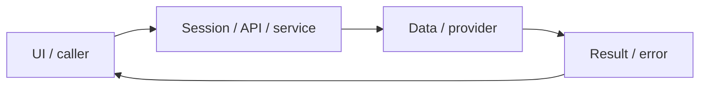

# System design — exam-practice

[Đặc tả](README.md) · [Functions](functions.md) · [UI](ui.md)

## Luồng thực tế

Exam list → start SQL attempt → autosave → server deadline/submit → scoreExam → writing queue → result UI

Sơ đồ khái quát ranh giới; chuỗi phía trên nêu rõ worker/provider/storage có áp dụng cho feature này.

## Dữ liệu và ownership

Đề trong Mongo ExamModel; exam_attempts SQL; index unique partial ở migration003. Khi hết deadline, server giữ câu trả lời đã lưu thay vì nhận chỉnh sửa muộn.

API cá nhân luôn lấy user từ session ở [api](../../../apps/api/src/auth/jwt.guard.ts), không nhận user_id tùy ý từ request. Mutation dùng JSON/Origin; lỗi auth 401/403 không phải dữ liệu trống hợp lệ.

## Hợp đồng tích hợp

- GET /api/exams[?attempt=...] — list/history hoặc owned attempt.
- POST /api/exams — {examId}; {id}; PATCH — {id,version,answers,submit}.
- PUT /api/exams — admin nhập examSchema có source/rights.

## Failure modes và vận hành

Chưa có kho đề đầy đủ có quyền sử dụng, chưa chia phiên PBT hoàn chỉnh, không quy đổi điểm thành chứng chỉ. Không triển khai TOPIK Speaking/IBT/IELTS/HSK/JLPT.

Phụ thuộc chung: [session/authorization](../../shared/auth-and-api.md), [storage/migrations](../../shared/data-model.md), [vận hành](../../shared/operations.md). Chỉ tên biến môi trường được ghi ở docs; không đưa token, cookie hay credential vào ví dụ/log.

## ORM data access — 2026-11-01

PostgreSQL dùng TypeORM EntitySchema/QueryBuilder; transaction dùng một QueryRunner, giữ ownership, row lock, CAS/version, JSONB và idempotency. MongoDB vẫn Mongoose. Hợp đồng dùng chung tại [ORM design](../postgresql-orm-migration/system-design.md); chi tiết regression ở [audit tích hợp](../../audits/postgresql-orm-migration.md). UI/layout không thay đổi.

## PostgreSQL-only — 2026-11-01

Current persistence: [content store](../../../packages/backend/src/content-store.ts), [mapped envelopes](../../../packages/backend/src/content-entities.ts), [atomic offline importer](../../../packages/backend/src/content-import.ts). Mongo models/connectDb are removed; existing routes, validation, ownership, version/CAS and snapshots remain. [Canonical migration contract](../postgresql-only/README.md) supersedes the earlier Mongo persistence descriptions; historical evidence is not new verification.
