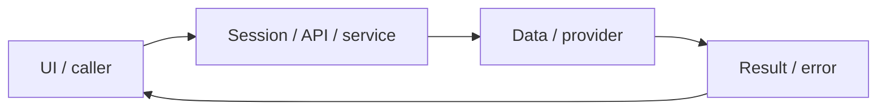

# System design — identity-auth

[Đặc tả](README.md) · [Functions](functions.md) · [UI](ui.md)

## Luồng thực tế

Form/Google → Better Auth → PostgreSQL account/session → cookie → useSession → Shell/API

Sơ đồ khái quát ranh giới; chuỗi phía trên nêu rõ worker/provider/storage có áp dụng cho feature này.

## Dữ liệu và ownership

auth_user, auth_account, auth_session, auth_verification trong PostgreSQL; SMTP/Mailpit chỉ phục vụ email, không tham gia OAuth.

API cá nhân luôn lấy user từ session ở [api](../../../lib/api.ts), không nhận user_id tùy ý từ request. Mutation dùng JSON/Origin; lỗi auth 401/403 không phải dữ liệu trống hợp lệ.

## Hợp đồng tích hợp

- GET/POST /api/auth/* — handler Better Auth cho sign-up/email, sign-in/email, sign-in/social, callback/google, get-session, verify-email, reset/change password, sign-out.
- GET /api/config — {google:boolean}, no-store; không trả credential.

## Failure modes và vận hành

OAuth từng lỗi redirect_uri_mismatch đã khắc phục; log 2026-10-30 ghi invalid_client vì secret không hợp lệ. Probe sau khi người dùng cập nhật trả invalid_grant với refresh token giả; sau đó chủ tài khoản đã đăng nhập thật, DB xác nhận một Google account có image và session hoạt động. Email đã có tài khoản phải dùng explicit linking. SMTP production chưa được cấu hình.

Phụ thuộc chung: [session/authorization](../../shared/auth-and-api.md), [storage/migrations](../../shared/data-model.md), [vận hành](../../shared/operations.md). Chỉ tên biến môi trường được ghi ở docs; không đưa token, cookie hay credential vào ví dụ/log.

## Cập nhật profile/auth 2026-10-30

Google login thực tế đã được chủ tài khoản xác nhận sau cập nhật secret; DB xác nhận provider/image/session (không ghi danh tính/token). Sign-in social và linkSocial dùng errorCallbackURL=/sign-in; lỗi account_not_linked hướng dẫn explicit linking, lỗi khác hiển thị thông báo chung, không phản chiếu raw query. [Auth route](../../../app/api/auth/[...all]/route.ts) handleAuth bọc withApiLogging và log callback outcome/mã whitelist, không query/Location/code/state. Redirected chỉ có nghĩa HTTP redirect, không tự chứng nhận session. [UI tests](../../../tests/e2e/profile-ui.spec.ts) và [audit nhóm](../../audits/profile-auth-integration.md).
