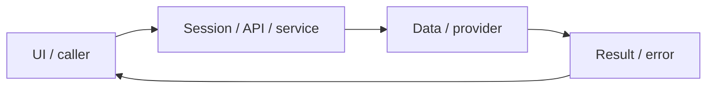

# System design — immersive-learning

[Đặc tả](README.md) · [Functions](functions.md) · [UI](ui.md)

## Luồng thực tế

Library tab → local TTS/MediaRecorder hoặc POST recordings → Google STT → AI góp ý → S3 + SQL → UI

Sơ đồ khái quát ranh giới; chuỗi phía trên nêu rõ worker/provider/storage có áp dụng cho feature này.

## Dữ liệu và ownership

readingLessons là nội dung code; recordings SQL lưu transcript/feedback/object key; audio ở S3. API audio tối đa 3MB, base64 tối đa 4.2 triệu ký tự.

API cá nhân luôn lấy user từ session ở [api](../../../lib/api.ts), không nhận user_id tùy ý từ request. Mutation dùng JSON/Origin; lỗi auth 401/403 không phải dữ liệu trống hợp lệ.

## Hợp đồng tích hợp

- GET /api/recordings[?id=...] — configured/history hoặc signed URL của chủ tài khoản.
- POST /api/recordings — {audio,consent:true}; thiếu config 503, audio không hợp lệ 400/413, không nhận dạng 422.

## Failure modes và vận hành

Google STT/S3 và microphone/TTS thiết bị thật chưa kiểm chứng toàn bộ. Không có điểm phát âm; chưa có audio người bản ngữ hoặc bản đồ từ đồng bộ transcript.

Phụ thuộc chung: [session/authorization](../../shared/auth-and-api.md), [storage/migrations](../../shared/data-model.md), [vận hành](../../shared/operations.md). Chỉ tên biến môi trường được ghi ở docs; không đưa token, cookie hay credential vào ví dụ/log.

## Audio mẫu — 2026-10-31

UI → SampleAudioPlayer → SpeechSynthesis ko-KR local → start/boundary/pause/resume/end/error → icon/progress/elapsed. Không thêm API, worker, DB hoặc quyền; [hợp đồng](../../shared/sample-audio-player.md).

## Rà soát audio controls — 2026-10-31 (đặc tả trước sửa)

Thay mọi text action nghe câu trong Library read/listen/speak bằng SampleAudioPlayer; AnswerDetails cũng dùng player chuẩn. Một player phát tại một thời điểm, đổi player dừng và reset player cũ ngay cả khi engine không emit cancel. Cleanup chỉ dừng session do chính component sở hữu; đổi bài/tab dừng đúng audio. Icon44px, compact progress/elapsed, nhãn theo câu, trạng thái loading/live/error rõ; giữ layout và liên kết lưu/tra cứu. Không thêm media duration giả hoặc tua TTS.

Triển khai theo thiết kế trên; [contract/lifecycle chuẩn](../../shared/sample-audio-player.md), [audit](../../audits/sentence-audio-controls.md).
