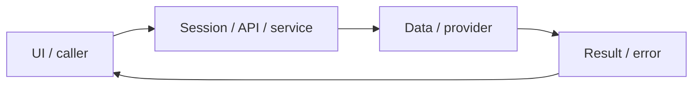

# System design — learning-records

[Đặc tả](README.md) · [Functions](functions.md) · [UI](ui.md)

## Luồng thực tế

Practice/Profile → API cá nhân → SQL ownership/version → history/stats/UI; CLI riêng đọc legacy Mongo → SQL

Sơ đồ khái quát ranh giới; chuỗi phía trên nêu rõ worker/provider/storage có áp dụng cho feature này.

## Dữ liệu và ownership

drafts, favorites, submissions, legacy_imports. Hai model Mongo cũ chỉ phục vụ di sản, API hiện hành dùng SQL.

API cá nhân luôn lấy user từ session ở [api](../../../lib/api.ts), không nhận user_id tùy ý từ request. Mutation dùng JSON/Origin; lỗi auth 401/403 không phải dữ liệu trống hợp lệ.

## Hợp đồng tích hợp

- GET/PUT /api/drafts — {sentenceId,text,version}; PUT trả version mới hoặc 409.
- GET /api/submissions — sentenceId tùy chọn; {submission} hoặc {submissions}.
- GET/POST /api/user/favorites — {favorites}; mutation {sentenceId,favorite}.
- GET /api/user/stats — totalCompleted,averageScore,weakTopics.

## Failure modes và vận hành

Import lịch sử thật chưa thực hiện vì phải đối chiếu UUID và tài khoản đã xác minh. Fixture từng kiểm tra import lần đầu 1, lần lặp 0.

Phụ thuộc chung: [session/authorization](../../shared/auth-and-api.md), [storage/migrations](../../shared/data-model.md), [vận hành](../../shared/operations.md). Chỉ tên biến môi trường được ghi ở docs; không đưa token, cookie hay credential vào ví dụ/log.
