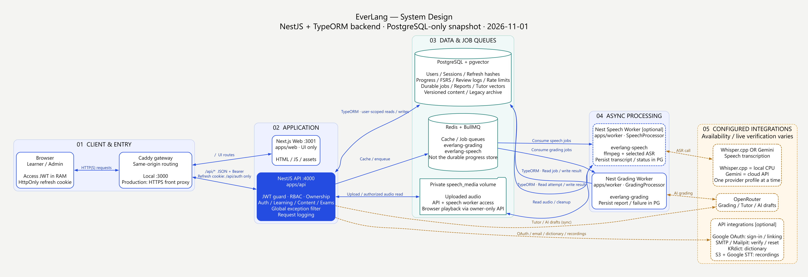
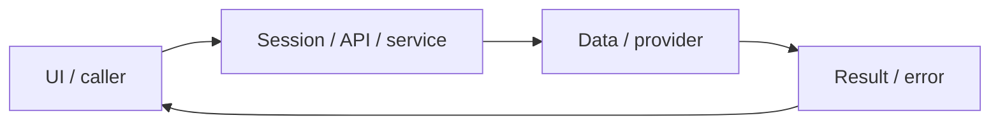

# System design — platform-operations

[Đặc tả](README.md) · [Functions](functions.md) · [UI](ui.md)

## Sơ đồ hệ thống — 2026-11-01

Thuyết minh/traceability chuẩn tại [shared architecture](../../shared/architecture.md#system-design-diagram); ảnh dùng chung với feature migration, không tạo hợp đồng kiến trúc thứ hai. Snapshot686d87c; provider tùy chọn không đồng nghĩa đã verified live. [SVG](assets/everlang-system-design.svg) · [DOT source](assets/everlang-system-design.dot) · [Cách dựng](assets/everlang-system-design.prompt.md).

## Luồng thực tế

Browser → Caddy gateway → Next web hoặc Nest API → JWT guard/services → SQL/Mongo/Redis/providers; native Nest workers qua BullMQ.

Sơ đồ khái quát ranh giới; chuỗi phía trên nêu rõ worker/provider/storage có áp dụng cho feature này.

## Dữ liệu và ownership

Internal planning data: work-items.json → validatePlanning → buildViews → generated WBS/backlog/sprint/task/dashboard + CSV. Source ở documentation/planning, owner platform-operations; không nằm trong runtime/app DB. Check mode không sửa file, sync mode chỉ sinh7 views cố định. Dependencies và evidence là guard cấu trúc, không thay PO review hoặc quality audit. Solo/reviewer do user xác nhận; hours/capacity/date chưa chốt nên các sprint Proposed.

Migrations001–008 giữ lịch sử và auth cutover; packages/backend/src/orm.ts dùng TypeORM DataSource/EntitySchema; migration runner nhận lịch sử001–008 vào orm_migrations. Redis queue có AOF/noeviction; packages/contracts chứa hợp đồng browser-safe.

API cá nhân luôn lấy user từ session ở [api](../../../apps/api/src/auth/jwt.guard.ts), không nhận user_id tùy ý từ request. Mutation dùng JSON/Origin; lỗi auth 401/403 không phải dữ liệu trống hợp lệ.

## Hợp đồng tích hợp

- JwtGuard.canActivate + GlobalExceptionFilter.respondError + ResponseInterceptor — native authentication, role và response/error boundary.
- query(sql,values), connectDb(), rateLimit(), getGradingQueue(), log/requestLogging là module shared.

## Failure modes và vận hành

Local Mailpit không chuyển email tới Gmail. Production cần SMTP/domain/HTTPS thật. Tên ảnh worker vẫn chứa dependencies development; chưa tối ưu kích thước image. docs:check chỉ là kiểm tra cấu trúc.

Phụ thuộc chung: [session/authorization](../../shared/auth-and-api.md), [storage/migrations](../../shared/data-model.md), [vận hành](../../shared/operations.md). Chỉ tên biến môi trường được ghi ở docs; không đưa token, cookie hay credential vào ví dụ/log.

## Bản sửa worker/error boundary — 2026-10-31 (implemented; đặc tả ghi trước code)

Tái sử dụng `log`/`logError` và Nest boundary requestLogging→JwtGuard→GlobalExceptionFilter. Pool idle errors có listener không nhận/log client; worker listeners/startup/recovery/shutdown đều có catch. Fatal process exception/rejection được log an toàn rồi exit1 để supervisor khởi động lại, không tiếp tục process hỏng. AI429 giữ HTTP status và Retry-After kể cả body không phải JSON; cooldown Redis toàn grading queue, retry hữu hạn3lần, lỗi cuối không lưu điểm giả, thông báo giữ nháp. Không đổi model/billing. Kiểm unit fault injection + real Redis/BullMQ cooldown + build/container.

Hợp đồng triển khai đầy đủ: [error handling](../../shared/error-handling.md).

## ORM data access — 2026-11-01

PostgreSQL dùng TypeORM EntitySchema/QueryBuilder; transaction dùng một QueryRunner, giữ ownership, row lock, CAS/version, JSONB và idempotency. MongoDB vẫn Mongoose. Hợp đồng dùng chung tại [ORM design](../postgresql-orm-migration/system-design.md); chi tiết regression ở [audit tích hợp](../../audits/postgresql-orm-migration.md). UI/layout không thay đổi.

## PostgreSQL-only — 2026-11-01

Current persistence: [content store](../../../packages/backend/src/content-store.ts), [mapped envelopes](../../../packages/backend/src/content-entities.ts), [atomic offline importer](../../../packages/backend/src/content-import.ts). Mongo models/connectDb are removed; existing routes, validation, ownership, version/CAS and snapshots remain. [Canonical migration contract](../postgresql-only/README.md) supersedes the earlier Mongo persistence descriptions; historical evidence is not new verification.
