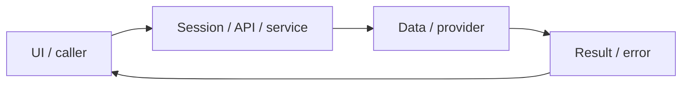

# System design — platform-operations

[Đặc tả](README.md) · [Functions](functions.md) · [UI](ui.md)

## Luồng thực tế

Browser → Next → API guard/services → SQL/Mongo/Redis/providers; Docker migrations → app/worker; Caddy → app

Sơ đồ khái quát ranh giới; chuỗi phía trên nêu rõ worker/provider/storage có áp dụng cho feature này.

## Dữ liệu và ownership

Internal planning data: work-items.json → validatePlanning → buildViews → generated WBS/backlog/sprint/task/dashboard + CSV. Source ở documentation/planning, owner platform-operations; không nằm trong runtime/app DB. Check mode không sửa file, sync mode chỉ sinh7 views cố định. Dependencies và evidence là guard cấu trúc, không thay PO review hoặc quality audit. Solo/reviewer do user xác nhận; hours/capacity/date chưa chốt nên các sprint Proposed.

Migrations001–003 tạo schema PostgreSQL; lib/sql/index dùng pg Pool + Drizzle auth; Redis queue có AOF/noeviction. lib/types là hợp đồng shared.

API cá nhân luôn lấy user từ session ở [api](../../../lib/api.ts), không nhận user_id tùy ý từ request. Mutation dùng JSON/Origin; lỗi auth 401/403 không phải dữ liệu trống hợp lệ.

## Hợp đồng tích hợp

- api(path,handler,admin) — guard và JSON/error wrapper.
- query(sql,values), connectDb(), rateLimit(), getGradingQueue(), log/withApiLogging là module shared.

## Failure modes và vận hành

Local Mailpit không chuyển email tới Gmail. Production cần SMTP/domain/HTTPS thật. Tên ảnh worker vẫn chứa dependencies development; chưa tối ưu kích thước image. docs:check chỉ là kiểm tra cấu trúc.

Phụ thuộc chung: [session/authorization](../../shared/auth-and-api.md), [storage/migrations](../../shared/data-model.md), [vận hành](../../shared/operations.md). Chỉ tên biến môi trường được ghi ở docs; không đưa token, cookie hay credential vào ví dụ/log.
