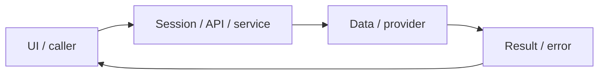

# System design — translation-practice

[Đặc tả](README.md) · [Functions](functions.md) · [UI](ui.md)

## Luồng thực tế

Practice → /api/sentences MongoDB → nháp SQL → grade/job → báo cáo/UI → lưu kiến thức vào SRS

Sơ đồ khái quát ranh giới; chuỗi phía trên nêu rõ worker/provider/storage có áp dụng cho feature này.

## Dữ liệu và ownership

Học liệu MongoDB; nháp/report/favorites PostgreSQL; dictionary có cache Redis. Search phía server dùng regex escape cần audit riêng ở cạnh trường hợp ký tự đặc biệt.

API cá nhân luôn lấy user từ session ở [api](../../../apps/api/src/auth/jwt.guard.ts), không nhận user_id tùy ý từ request. Mutation dùng JSON/Origin; lỗi auth 401/403 không phải dữ liệu trống hợp lệ.

## Hợp đồng tích hợp

- GET /api/sentences — topic,level,page,limit,search,sentenceId,mistakes; {items,page,limit,total,pages}.

## Failure modes và vận hành

Limit hiện tối đa 50, API lịch sử tối đa 200; chưa có server pagination toàn bộ lịch sử. Nút lưu kiến thức mở trang kho từ với dữ liệu điền sẵn, người dùng vẫn phải lưu thẻ.

Phụ thuộc chung: [session/authorization](../../shared/auth-and-api.md), [storage/migrations](../../shared/data-model.md), [vận hành](../../shared/operations.md). Chỉ tên biến môi trường được ghi ở docs; không đưa token, cookie hay credential vào ví dụ/log.

## Audio mẫu — 2026-10-31

UI → SampleAudioPlayer → SpeechSynthesis ko-KR local → start/boundary/pause/resume/end/error → icon/progress/elapsed. Không thêm API, worker, DB hoặc quyền; [hợp đồng](../../shared/sample-audio-player.md).

## Rà soát audio controls — 2026-10-31 (đặc tả trước sửa)

Thay mọi text action nghe câu trong Library read/listen/speak bằng SampleAudioPlayer; AnswerDetails cũng dùng player chuẩn. Một player phát tại một thời điểm, đổi player dừng và reset player cũ ngay cả khi engine không emit cancel. Cleanup chỉ dừng session do chính component sở hữu; đổi bài/tab dừng đúng audio. Icon44px, compact progress/elapsed, nhãn theo câu, trạng thái loading/live/error rõ; giữ layout và liên kết lưu/tra cứu. Không thêm media duration giả hoặc tua TTS.

Triển khai theo thiết kế trên; [contract/lifecycle chuẩn](../../shared/sample-audio-player.md), [audit](../../audits/sentence-audio-controls.md).

## Retry failed grading —2026-10-31 (đặc tả trước sửa)

POST grade gặp cùng dedup_key đã failed trả409/code GRADING_PREVIOUS_FAILED/submissionId/retryable, không502 và không enqueue tự động. UI giữ nháp, hiện nút Chấm lại bằng AI ngay trong alert (không phụ thuộc report modal); click explicit forceRegrade=true với requestId mới. Polling failure cũng có retry tại chỗ. Cache completed/dedup queued/ownership/rate limit/worker cooldown giữ nguyên.

## ORM data access — 2026-11-01

PostgreSQL dùng TypeORM EntitySchema/QueryBuilder; transaction dùng một QueryRunner, giữ ownership, row lock, CAS/version, JSONB và idempotency. MongoDB vẫn Mongoose. Hợp đồng dùng chung tại [ORM design](../postgresql-orm-migration/system-design.md); chi tiết regression ở [audit tích hợp](../../audits/postgresql-orm-migration.md). UI/layout không thay đổi.
