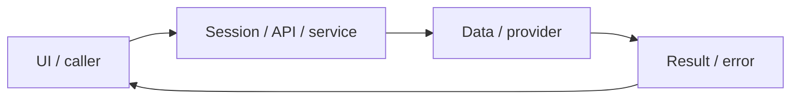

# System design — translation-practice

[Đặc tả](README.md) · [Functions](functions.md) · [UI](ui.md)

## Luồng thực tế

Practice → /api/sentences MongoDB → nháp SQL → grade/job → báo cáo/UI → lưu kiến thức vào SRS

Sơ đồ khái quát ranh giới; chuỗi phía trên nêu rõ worker/provider/storage có áp dụng cho feature này.

## Dữ liệu và ownership

Học liệu MongoDB; nháp/report/favorites PostgreSQL; dictionary có cache Redis. Search phía server dùng regex escape cần audit riêng ở cạnh trường hợp ký tự đặc biệt.

API cá nhân luôn lấy user từ session ở [api](../../../lib/api.ts), không nhận user_id tùy ý từ request. Mutation dùng JSON/Origin; lỗi auth 401/403 không phải dữ liệu trống hợp lệ.

## Hợp đồng tích hợp

- GET /api/sentences — topic,level,page,limit,search,sentenceId,mistakes; {items,page,limit,total,pages}.

## Failure modes và vận hành

Limit hiện tối đa 50, API lịch sử tối đa 200; chưa có server pagination toàn bộ lịch sử. Nút lưu kiến thức mở trang kho từ với dữ liệu điền sẵn, người dùng vẫn phải lưu thẻ.

Phụ thuộc chung: [session/authorization](../../shared/auth-and-api.md), [storage/migrations](../../shared/data-model.md), [vận hành](../../shared/operations.md). Chỉ tên biến môi trường được ghi ở docs; không đưa token, cookie hay credential vào ví dụ/log.
