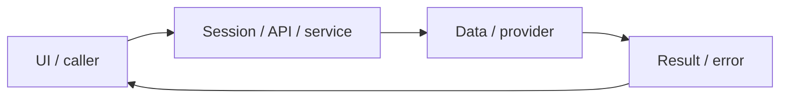

# System design — user-profile

[Đặc tả](README.md) · [Functions](functions.md) · [UI](ui.md)

## Luồng thực tế

Profile UI → api session/ownership → Better Auth updateUser + SQL profiles → thông báo UI

Sơ đồ khái quát ranh giới; chuỗi phía trên nêu rõ worker/provider/storage có áp dụng cho feature này.

## Dữ liệu và ownership

Tên/email/image nằm ở auth_user; level/goal/minutes/timezone nằm ở profiles. Hiện PUT gọi updateUser rồi SQL riêng, chưa phải transaction chung.

API cá nhân luôn lấy user từ session ở [api](../../../lib/api.ts), không nhận user_id tùy ý từ request. Mutation dùng JSON/Origin; lỗi auth 401/403 không phải dữ liệu trống hợp lệ.

## Hợp đồng tích hợp

- GET /api/profile — {profile,user,googleEnabled}.
- PUT /api/profile — {name,level,goal,minutes,timezone}; {saved:true}; 400 validation, 401/403 auth.

## Failure modes và vận hành

Feature này là baseline trước mở rộng profile. Avatar không được render trong Shell; cập nhật tên chưa chủ động refresh cache session. Các lỗi này chưa được sửa trong commit tài liệu.

Phụ thuộc chung: [session/authorization](../../shared/auth-and-api.md), [storage/migrations](../../shared/data-model.md), [vận hành](../../shared/operations.md). Chỉ tên biến môi trường được ghi ở docs; không đưa token, cookie hay credential vào ví dụ/log.
