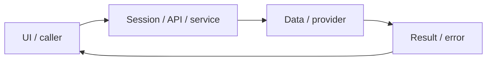

# System design — vocabulary-srs

[Đặc tả](README.md) · [Functions](functions.md) · [UI](ui.md)

## Luồng thực tế

Kho từ/review UI → API → SQL row lock/version → FSRS review → card/review_logs commit → refresh UI/dashboard

Sơ đồ khái quát ranh giới; chuỗi phía trên nêu rõ worker/provider/storage có áp dụng cho feature này.

## Dữ liệu và ownership

vocabulary, review_logs; due là timestamp, version tăng khi sửa/ôn. JSON card phục hồi dueAt/lastReviewAt thành Date.

API cá nhân luôn lấy user từ session ở [api](../../../apps/api/src/auth/jwt.guard.ts), không nhận user_id tùy ý từ request. Mutation dùng JSON/Origin; lỗi auth 401/403 không phải dữ liệu trống hợp lệ.

## Hợp đồng tích hợp

- GET /api/vocabulary?due=true — {items,dueCount,serverNow}, tối đa 500.
- POST/PUT /api/vocabulary — term,meaning,context,note,kind,sourceId; PUT thêm id/version/suspended.
- POST /api/reviews — {id,rating:1..4,version,requestId}; 404 ownership, 409 stale/due.

## Failure modes và vận hành

Chưa có optimizer cá nhân hóa từ lịch sử dài hạn; dùng preset FSRS-7.

Phụ thuộc chung: [session/authorization](../../shared/auth-and-api.md), [storage/migrations](../../shared/data-model.md), [vận hành](../../shared/operations.md). Chỉ tên biến môi trường được ghi ở docs; không đưa token, cookie hay credential vào ví dụ/log.

Migration007 cần app bridge trước khi áp dụng; giữ nguyên FSRS/card id/log, thay old constraint bằng2 partial indexes manual/catalog. Rollback phải `everlang-vocabulary-bridge:local` hoặc bản mới hơn, không pre-bridge. [ADR/migration](../vocabulary-catalog/system-design.md).

## 2026-11-01 — Due-card clock authority

VocabularyService.get trả serverNow ISO từ PostgreSQL cùng dueCount; Vocabulary.load dùng timestamp này để chọn thẻ due, không dùng đồng hồ thiết bị. Không sửa card/due/rating/FSRS; browser lệch sau không ẩn thẻ đã đến hạn, lệch trước không mở thẻ tương lai. Regression trong tests/e2e/vocabulary-catalog.spec.ts mô phỏng -5phút và +365ngày.

## ORM data access — 2026-11-01

PostgreSQL dùng TypeORM EntitySchema/QueryBuilder; transaction dùng một QueryRunner, giữ ownership, row lock, CAS/version, JSONB và idempotency. MongoDB vẫn Mongoose. Hợp đồng dùng chung tại [ORM design](../postgresql-orm-migration/system-design.md); chi tiết regression ở [audit tích hợp](../../audits/postgresql-orm-migration.md). UI/layout không thay đổi.
