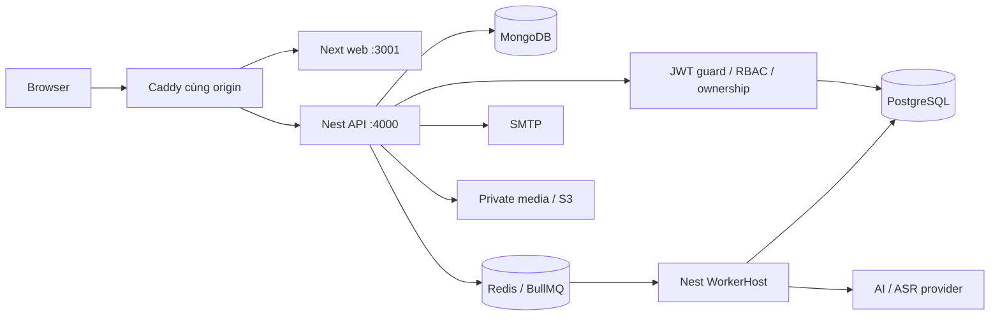

# Kiến trúc hiện tại — 2026-11-01

Monorepo ba runtime: Next.js chỉ render UI tại `apps/web`, NestJS HTTP tại `apps/api`, NestJS ApplicationContext/BullMQ tại `apps/worker`. Hợp đồng browser-safe ở `packages/contracts`; dữ liệu, provider, queue và log dùng chung ở `packages/backend`. [Code map](../code-map.json) là bảng owner chuẩn.

Access JWT RS256 15 phút chỉ trong RAM, gửi Bearer; refresh opaque 30 ngày tuyệt đối ở HttpOnly cookie. Cookie không cấp quyền cho API nghiệp vụ. Native AuthService kiểm active session cùng JWT, PostgreSQL là nguồn thu hồi phiên. Guard kiểm email/admin, service kiểm ownership. Không có Next API route, Better Auth hoặc adapter fallback.

PostgreSQL giữ tiến độ, SRS, durable grading/speech jobs; MongoDB giữ học liệu phiên bản. Redis không giữ tiến độ lâu dài. Học liệu knowledge/catalog là của hệ thống theo language; lưu, note, SRS và tiến độ là riêng user. Snapshot/rubric/idempotency/version giữ nguyên qua migration. Các provider ngoài chỉ được coi verified khi có evidence thực tế.

[Auth/API](auth-and-api.md) · [Lỗi/log](error-handling.md) · [Vận hành](operations.md) · [Audit migration](../features/backend-nestjs-migration/audit.md).
