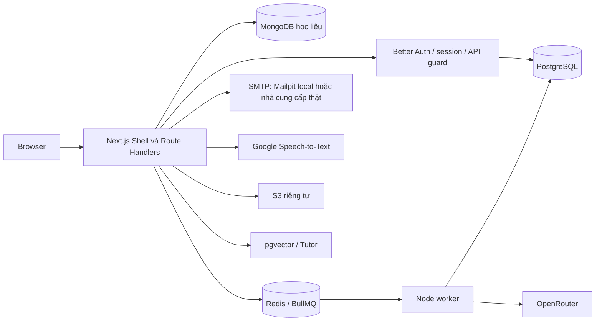

# System design hiện tại — 2026-10-30

Next.js nguyên khối theo module và worker riêng. [Code map](../code-map.json) xác định owner cho từng file; [feature index](../README.md) chứa đặc tả chi tiết.

Browser chỉ gửi cookie session; API lấy danh tính từ Better Auth, không tin `x-user-id`. PostgreSQL giữ dữ liệu cá nhân; MongoDB giữ đề/học liệu có phiên bản. Redis không phải nguồn tiến độ lâu dài. Worker lưu kết quả chấm trong PostgreSQL; browser theo dõi job và nhận báo cáo. Snapshot đề/rubric bảo vệ lịch sử khi học liệu thay đổi.

Luồng chính: luyện dịch → job chấm → báo cáo/lưu từ → SRS → dashboard ngày địa phương. Profile cung cấp phút/ngày và múi giờ cho lần tạo lịch tiếp theo. Lịch có sẵn trong ngày giữ snapshot. Caddy là reverse proxy HTTPS trong cấu hình production; local chỉ bind loopback.

S3/STT/Tutor có code tích hợp nhưng còn phụ thuộc cấu hình và xác minh dịch vụ; không coi sơ đồ này là bằng chứng chạy thành công. Xem [audit tích hợp](../audits/baseline-integration.md).

## Knowledge library — 2026-10-31

[Thư viện kiến thức](../features/knowledge-library/system-design.md) dùng Route Handlers/service trong monolith: học liệu versioned ở MongoDB, notes/progress/attempts ở PostgreSQL; không thêm backend framework hoặc queue riêng. TTS là thiết bị, chưa audio curated/scoring.

## Speech worker boundary

[self-hosted-speech](../features/self-hosted-speech/system-design.md) là module cùng monolith và Node worker queue riêng. SQL durable outbox + private volume là nguồn chính; Redis queue/heartbeat không chứa kết quả lâu dài. Gemini API là optional explicit external provider, Whisper CPU local là option khác; không chạy đồng thời hai profile worker cùng queue/heartbeat. Không đưa learner reference vào ASR.
