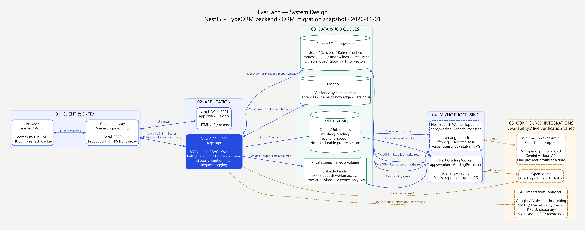
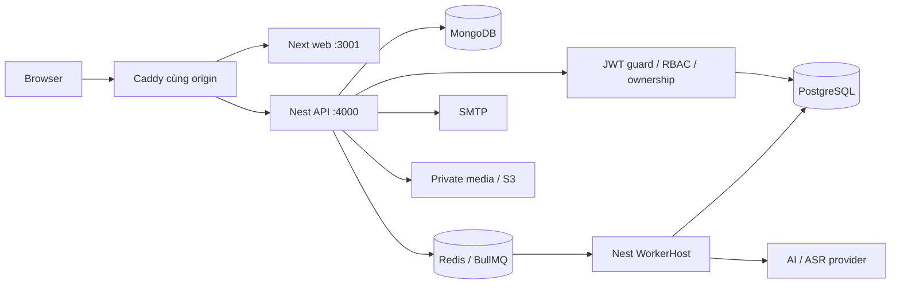

# Kiến trúc hiện tại — 2026-11-01

Monorepo ba runtime: Next.js chỉ render UI tại `apps/web`, NestJS HTTP tại `apps/api`, NestJS ApplicationContext/BullMQ tại `apps/worker`. Hợp đồng browser-safe ở `packages/contracts`; dữ liệu, provider, queue và log dùng chung ở `packages/backend`. [Code map](../code-map.json) là bảng owner chuẩn.

## System design diagram

Snapshot ORM branch `refactor/typeorm-data-access`, 2026-11-01. Ảnh mô tả topology/hợp đồng trong code; không chứng nhận mọi provider đã bật hoặc được kiểm thử live.

[PNG3840px](../features/platform-operations/assets/everlang-system-design.png) · [SVG phóng to](../features/platform-operations/assets/everlang-system-design.svg) · [Nguồn DOT](../features/platform-operations/assets/everlang-system-design.dot) · [Cách dựng/provenance](../features/platform-operations/assets/everlang-system-design.prompt.md). Mũi tên xanh biểu diễn liên kết core; nét đứt màu cam là tích hợp theo cấu hình. Các bảng bên dưới giải thích chi tiết các mũi tên; Mermaid là bản tóm tắt có thể sửa trực tiếp.

Access JWT RS256 15 phút chỉ trong RAM, gửi Bearer; refresh opaque 30 ngày tuyệt đối ở HttpOnly cookie. Cookie không cấp quyền cho API nghiệp vụ. Native AuthService kiểm active session cùng JWT, PostgreSQL là nguồn thu hồi phiên. Guard kiểm email/admin, service kiểm ownership. Không có Next API route, Better Auth hoặc adapter fallback.

PostgreSQL giữ tiến độ, SRS, durable grading/speech jobs; MongoDB giữ học liệu phiên bản. Redis không giữ tiến độ lâu dài. Học liệu knowledge/catalog là của hệ thống theo language; lưu, note, SRS và tiến độ là riêng user. Snapshot/rubric/idempotency/version giữ nguyên qua migration. Các provider ngoài chỉ được coi verified khi có evidence thực tế.

[Auth/API](auth-and-api.md) · [Lỗi/log](error-handling.md) · [Vận hành](operations.md) · [Audit migration](../features/backend-nestjs-migration/audit.md).

## Thành phần nào giao tiếp với nhau?

| Thành phần | Giao tiếp / trách nhiệm | Điểm thực thi |
|---|---|---|
| Browser ↔ Caddy ↔ Next web | Nhận HTML/JS/assets; gateway chuyển các route giao diện tới web3001. Local truy cập gateway3000; production có Caddy HTTPS phía trước. | [Gatewayfile](../../Gatewayfile), [Compose](../../docker-compose.yml), [web layout](../../apps/web/app/layout.tsx) |
| Browser ↔ Caddy ↔ Nest API | `/api/*` tới API4000; dữ liệu riêng tư dùng Bearer JWT. Browser không kết nối SQL/Mongo/Redis trực tiếp. | [AuthProvider/apiFetch](../../apps/web/lib/auth.tsx), [API bootstrap](../../apps/api/src/main.ts) |
| Nest API ↔ PostgreSQL | Auth sessions/refresh hash, dữ liệu người học, FSRS, job durable, báo cáo, exam attempts và vector Tutor. Guard kiểm quyền; service kiểm ownership/transaction. | [AuthService](../../apps/api/src/auth/auth.service.ts), [JwtGuard](../../apps/api/src/auth/jwt.guard.ts), [TypeORM DataSource](../../packages/backend/src/orm.ts) |
| Nest API ↔ MongoDB | Đọc/biên tập học liệu có phiên bản: sentence, exam, knowledge và catalogue. Học liệu hệ thống dùng chung; trạng thái lưu/học riêng user nằm PG. | [connectDb](../../packages/backend/src/db.ts), [content](../../packages/backend/src/content.ts), [knowledge](../../packages/backend/src/knowledge.ts), [catalogue](../../packages/backend/src/vocabulary-catalog.ts) |
| Nest API ↔ Redis/BullMQ → workers | Cache, enqueue; queue `everlang-grading` và `everlang-speech` được xử lý độc lập. Redis không thay nguồn trạng thái durable trong PG. | [redis/getGradingQueue](../../packages/backend/src/redis.ts), [enqueueSpeech](../../packages/backend/src/speech/queue.ts), [WorkerModule](../../apps/worker/src/main.ts) |
| Workers ↔ PostgreSQL / providers | Worker lấy snapshot/trạng thái durable, gọi provider tương ứng rồi ghi kết quả/lỗi về PG; trình duyệt đọc qua API. Grading dùng OpenRouter; speech chọn Whisper.cpp hoặc Gemini. | [GradingProcessor](../../apps/worker/src/grading.processor.ts), [SpeechProcessor](../../apps/worker/src/speech.processor.ts) |
| API + speech worker ↔ private volume | API lưu upload; worker đọc để chuyển mã/ASR. API chỉ trả audio cho owner; web fetch Bearer rồi phát blob URL. | [SpeechService](../../apps/api/src/domains/speech.service.ts), [speech storage](../../packages/backend/src/speech/storage.ts), [SpeechAudioService](../../apps/api/src/domains/speech-audio.service.ts), [PrivateAudio](../../apps/web/components/private-audio.tsx) |
| API ↔ tích hợp tùy chọn | Google OAuth; SMTP/Mailpit verify/reset; KRdict; OpenRouter cho Tutor/AI draft; recordings dùng S3/Google STT khi cấu hình. Những lời gọi đồng bộ này không mặc định qua grading worker. | [AuthService](../../apps/api/src/auth/auth.service.ts), [DictionaryService](../../apps/api/src/domains/dictionary.service.ts), [TutorService](../../apps/api/src/domains/tutor.service.ts), [RecordingsService](../../apps/api/src/domains/recordings.service.ts) |

`packages/contracts` và `packages/backend` là thư viện được import, không phải microservice hay endpoint HTTP. Web chỉ dùng contracts/browser modules; server secrets/provider/database code ở API/worker.

## Ba luồng chính trong ảnh

1. **Đăng nhập:** browser lấy CSRF rồi POST sign-in → AuthService kiểm credential/verify → PG tạo refresh family/hash → response cấp access JWT900s và refresh HttpOnly cookie. API nghiệp vụ kiểm JWT + session còn hiệu lực. Refresh rotate; reuse/logout/reset thu hồi session. Google đi qua redirect browser → Google → callback API, rồi API exchange code/verify ID token; không qua SMTP để đổi Google token.
2. **Chấm bài:** POST `/api/submissions/grade` → PG lưu snapshot/job → BullMQ enqueue → GradingProcessor gọi OpenRouter → PG lưu report hoặc lỗi → browser poll `/api/jobs?id=...` để đọc PG. UI không poll Redis/worker trực tiếp. Cache completed200, queued202, cached failed409 với retry explicit; không tự giả điểm khi provider lỗi.
3. **Speech:** consent + upload → PG staging + file private → speech queue → SpeechProcessor đọc file, ffmpeg và provider đã chọn → PG lưu transcript/status → browser poll `/api/speech`. Playback `/api/speech/audio?id=...` phải qua Bearer/ownership, rồi blob URL; mặc định speech disabled, hai provider profiles không chạy đồng thời.

Đọc/lưu học liệu không cần đi qua AI: API đọc nội dung hệ thống từ MongoDB, lưu bookmark/note/card/tiến độ của user trong PG. SRS review cập nhật card/review log theo version; UI chọn thẻ đến hạn bằng `serverNow` từ PG, tránh lệch đồng hồ thiết bị.

## Tracing và trạng thái triển khai

`requestLogging` gắn requestId/AsyncLocalStorage → CorrelatedQueue truyền `trace.requestId` → worker log thêm jobId/attempt → kết quả/lỗi được API chuẩn hóa. GlobalExceptionFilter bắt lỗi HTTP; fatal process handlers kết thúc process lỗi để supervisor restart. Log JSON có redaction/rotation; hiện không có collector/APM tập trung riêng được triển khai trong sơ đồ.

Core Nest/JWT/PG/Mongo/queue và các luồng regression local đã có evidence ở [migration audit](../features/backend-nestjs-migration/audit.md). Google live login/link, cloud inference và production SMTP/HTTPS vẫn giữ giới hạn xác minh tại audit. Nét đứt biểu diễn tích hợp tùy cấu hình, không có nghĩa tất cả đã bật; Whisper.cpp chạy local CPU, Gemini là dịch vụ cloud.

## ORM và Redis — 2026-11-01

PostgreSQL runtime dùng [TypeORM](../../packages/backend/src/orm.ts) với [25 EntitySchemas](../../packages/backend/src/entities.ts), Mongoose tiếp tục quản lý MongoDB. synchronize/dropSchema luôn false. Auth, tiến độ, review và rate limit được lưu/kiểm tra trong PostgreSQL; Redis chỉ cache và queue. [rateLimit](../../packages/backend/src/rate-limit.ts) dùng counter nguyên tử theo phút, không reset quota khi Redis phục hồi. Redis lỗi: ready trả200/status degraded/queueAvailable false; chức năng cần queue trả503/QUEUE_UNAVAILABLE cùng requestId, bản ghi durable còn nguyên, gửi lại cùng requestId khi queue phục hồi. Endpoint khác phụ thuộc Redis/provider vẫn có thể lỗi theo hợp đồng riêng. [Đặc tả và evidence](../features/postgresql-orm-migration/README.md).

Redis request client commandTimeout2s và readiness kiểm connection status trước PING, tránh probe chờ vòng reconnect. API Compose không chờ Redis healthy để khởi động; worker vẫn phụ thuộc Redis. Queues tự reconnect; lỗi HTTP mang requestId theo global filter.
